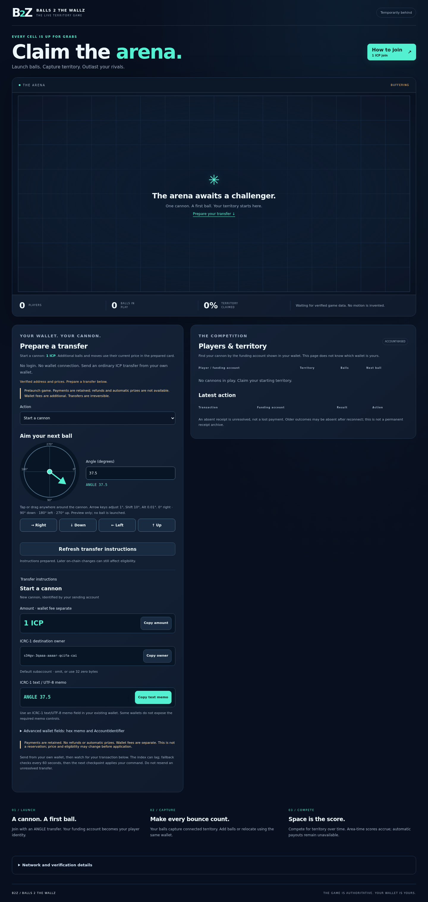
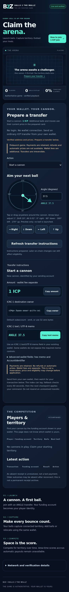

# B2Z identity and prefix-free memos

Completed on 2026-10-20 under the user's explicit tested prelaunch deployment authorization. The existing backend was upgraded in place, followed by the existing observer's assets. No reset, reinstall, canister creation on mainnet, controller change, funding transfer, price change, Event Horizon change, remote Git operation or DTR modification occurred.

The current checkout is `/home/codexdev/src/b2z`, branch `checkpoint/b2z-identity-and-memos`. Its `.git` directory and configuration retained their inodes; HEAD, branch and remote names matched before and after the atomic workspace move. The repository slug remains `balls-2-the-wallz`.

## Commands and compatibility

Canonical commands are `ANGLE 37.5`, `ANGLE 225` and `MOVE 83`. The CLI and website emit no product prefix. The original UTF-8 memo is bounded to 1–32 ASCII bytes. Only surrounding ASCII spaces are allowed; interior separators are single spaces. Keywords are ASCII case-insensitive. ANGLE is an unsigned integer or decimal from 0 through 359.99, with at most two fractional digits. MOVE is an unsigned 32-bit cell ID. The existing game separately checks board bounds, eligibility and ownership. Controls, non-ASCII/malformed UTF-8, signs, exponent notation, extra commands/fields, trailing junk and overflow reject. Authoritative centidegrees map to the existing heading using integer rounding; physics is unchanged.

Adapter v3 accepts the published S15 `BTZ ` text prefix, historic eight-byte binary commands and absent-blob legacy numeric commands. A present invalid or empty blob never falls back. Explicit v1/v2 raw replay helpers preserve historical grammar and classification. Stored canonical pending inputs are never reparsed.

The eight-byte ambiguity is fixed in Rust and JavaScript: binary decoding requires the actual historic three-byte magic, then validates opcode and reserved bits. Eight-byte ASCII `ANGLE 12`, `ANGLE 99` and `MOVE 123` reach the text parser. Shared original-byte fixtures require identical normalized eight-byte output or rejection in both languages. Existing S15 fixture bytes remain unchanged. See the [complete grammar](../docs/specs/B2Z_TEXT_MEMOS.md).

## Naming migration and retained bytes

Current directories are `apps/b2z-observer`, `crates/b2z-protocol`, `kernels/b2z-mechanics`, `native/b2z-native`, and `packages/kernels/b2z` / `b2z-v2`. npm is `b2z-application`; Rust package/import names, application symbols, tools, test/scenario/fixture filenames, current specification filenames, generated paths, UI/accessibility text and operational instructions use B2Z/b2z. Dependencies and algorithms are unchanged. The `b2z` DFX alias resolves to the same backend principal; `observer` resolves to the same frontend principal.

Intentionally retained protocol identity includes `42 54 5a`, `BTZPAY02`, `BTZCUT02`, the v2/v3 rules/schema tags, `BTZ-SPAWN-INPUT-03`, `BTZ-SPAWN-RANK-03`, `BTZ-ICP-INDEX-01`, `BTZ-ICP-INDEX-ANCHOR-01` and `btz-animation-1`. Old text prefixes, frozen fixture discriminators/provenance and published measurement schemas remain compatibility data. The [identifier policy](../docs/architecture/LEGACY_IDENTIFIERS.md) explains every category, including the historical root checkpoint/checksum manifests. No bytes were hidden to satisfy a search. The audit classifies every remaining occurrence. All 726 existing fixture, recording, benchmark, reference and archived evidence/manifest files compared byte-identically to baseline `75491ea287df97eb2677f47043b37795dbe3b423`, accounting only for renamed paths.

## Verification

| Check | Result |
|---|---|
| Source suite | PASS: 1,320 JavaScript / 137 Python tests; reference/golden/recording drift checks, naming and documentation checks |
| Native | PASS: 21 workspace / eight portable Rust tests; exact public game/host conformance and Life boundary; formatting/Clippy |
| Normal Wasm/Candid | PASS: locked normal build, host/source tests, unchanged declared/generated Candid, normal export inventory, formatting/Clippy |
| Browser replay | PASS: HTTP/CSP/native Web Crypto, playback/pause/buffer exhaustion/recovery, responsive layout |
| Default installed index suite | PASS: 18 functions; three explicit historical/upgrade probes excluded from default selection |
| Exact S15 recovery | PASS separately, before and after workspace move: two players, completed publications and two normalized pending inputs; 40 publications replayed in the final run |
| Final-location DFX asset/browser run | PASS: 20 acceptance groups, actual asset-canister hosting and 33 publications replayed |
| Isolated published DTR consumers | PASS with exact pinned revision/package; DTR CHANGES: NONE |
| New GitHub CI | NOT_RUN; user must publish this branch |

The actual upstream local ICP ledger accepted `icrc1_transfer` with UTF-8 `ANGLE 37.5`; the upstream index returned those bytes and the expected existing internal command produced an accepted cannon action and certified observer result. The text-path case reads all eight original transactions through the index and assigns each once. `MOVE 123` normalizes correctly and receives ordinary `NOT_OWN_TERRITORY`; the following ANGLE succeeds. Invalid and empty memos do not block scanning. Canonical payloads retain the original funding account/amount/transaction IDs; source digests bind the original raw Candid transaction, including fees. Native and JavaScript compare each run's actual captured canonical inputs and seals.

In the old-module probe, the pending prefix-free text normalized as invalid by adapter v2 remains `MALFORMED_MEMO` after upgrading to v3. Publication bytes, cursor, inbox, controllers, identity, scores and payment tally survive. No historical rejected payment becomes accepted by reprocessing.

## Deployed artifacts and preserved state

Clean production source: `8dd26d03b4945a016268a8a2f6e885eb0e427d5d` (with naming implementation commit `393c769`). Normal Wasm frozen under `.work/b2z-identity/release-frozen/` is byte-identical to the final-location installed-test artifact. Observer files frozen under `.work/b2z-identity/observer-frozen/` match the rehearsal's production files and the actual public responses.

| Artifact | SHA-256 |
|---|---|
| Prior backend | `c831ecaa2ac1f4b7ed51179e2b880d01f32c19e5d03b3e2214027677f378dde4` |
| Deployed backend | `187df32c5c95623abf13f52a626c9daeb3ee36591e9f6cf0d27cad8b109f4ce1` |
| Unchanged Candid | `87ace6e282f328df49e3a343e4108ab62991a0ea94df60c1be395162d02ef8cd` |
| Unchanged frontend asset-canister module | `04e565b3425fe7510ee16b02adcfe3f01abc9a2725c82a21cb08969241debd62` |
| Deployed observer app bundle | `75d00582996f00a015599b6f7c2050615dc98c155a3ed5f817c95a3a03ab9dd4` |
| Deployed index.html | `413ffaf14f76721baaaff6f5ebbbdc5bae72801e6741aadb7e7783a373445bde` |

Before upgrade, genuine mainnet certificate verification captured segment 7161, empty world/scores, zero received ICP, source cursor 0 and zero pending inputs. All three retained publication catalogs and every artifact chunk were hash-verified and remained byte-identical across the paused upgrade, along with state/events/scores, source descriptor and configuration/rules/schema/source identities. Controllers and receiving account remained unchanged. Existing run configuration resumed exactly: two logical ticks, one-second pacing, 512 work. Actual cycle balances and controller lists are in the [release evidence](../evidence/B2Z/release.json).

The backend is still `s34gv-3qaaa-aaaar-qcifa-cai`; frontend is still `s45ab-wiaaa-aaaar-qcifq-cai`. Join remains authenticated **1 ICP**, ball base **0.1 ICP × active-count²**, MOVE **0.0001 ICP**, wallet fees separate. Configuration hash remains `05f9b342c37d7dd5e53d6f12dce90d2ba53988ec3c1ccfeaedd8906f51042a42`. ICRC owner is the backend principal, default subaccount omitted or 32 zero bytes. Derived AccountIdentifier remains:

```
344885ef3e3823194dbc0367cd02c4cbe69f7dca0ba764f15f2a86e70dbeca7a
```

## Public browser and health

The [public observer](https://s45ab-wiaaa-aaaar-qcifq-cai.icp0.io/) passed B2Z branding, exact `ANGLE 37.5` / `414e474c452033372e35` native copying, authenticated destination/1 ICP amount, all pointer quadrants, numeric/keyboard/touch input, preserved selection, desktop/tablet/mobile, disconnected local aiming with unavailable payment copies, and certified reconnect. No uncaught page errors or gameplay update requests occurred; browser POSTs were exclusively query/read-state. Genuine verification used the standard SDK mainnet root, without replacement root, proxy or root fetching.

With our observing browser closed, certified segments advanced **7167 → 7172**. The final separate certified snapshot reached **7205**. Source binding is checked, index/run errors are clear, pending input count and source cursor remain zero. The official index and receiving account are unchanged; fixed 60-second fallback remains active and Event Horizon remains disabled.





[Local owned-cell MOVE preparation](../evidence/B2Z/local-owned-move.png) exercises a populated real-ledger local scene. One desktop capture shows temporary buffering, consistent with the existing S15 presentation/cadence limitation; authenticated payment preparation remains fresh. No cadence or physics change is included in this naming release.

No real mainnet gameplay ICP was sent. A real prefix-free mainnet memo payment remains user-owned and unverified. New CI awaits user publication. No additional milestone starts automatically.

```
git -C /home/codexdev/src/b2z push -u origin checkpoint/b2z-identity-and-memos
```
