# Approved reference and actual native-browser evidence

All captures below are actual application screenshots, not generated mockups.
Shared-panel captures use populated canonical gameplay fixtures; authentication
claims apply only to the separately labelled installed-game and mainnet sections.
Full scenes retain context and scroll boundaries. CSS viewport sizes are stated;
DPR2/3 captures have larger pixel dimensions. Software Chromium is not a physical
phone or subjective listening test. Runtime inputs match frozen `fd69939a…`.

## Owner reference (unchanged)

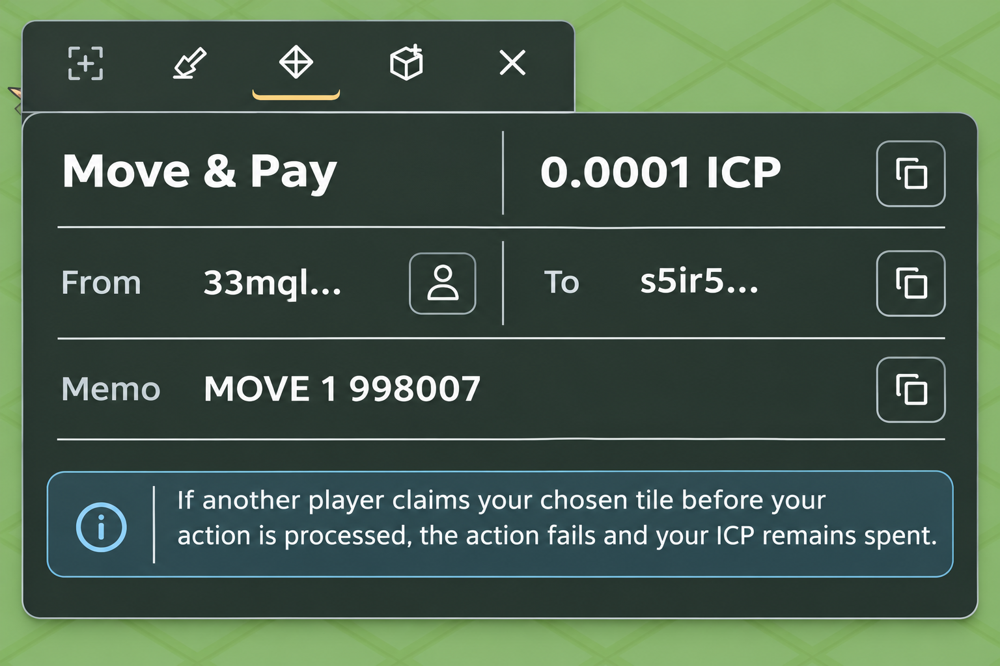

## Shared panel — desktop and portrait

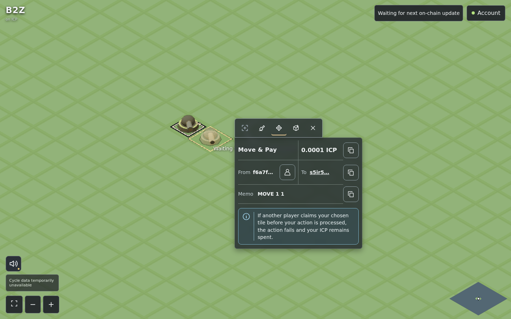
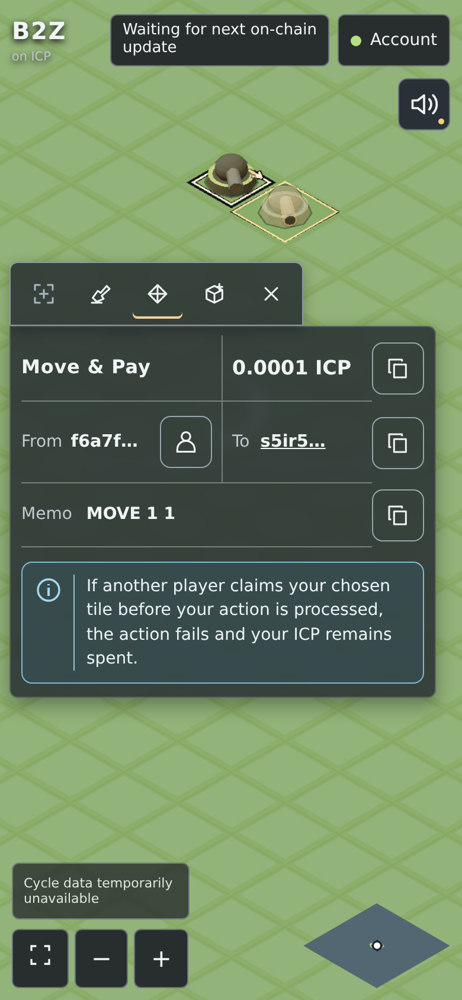
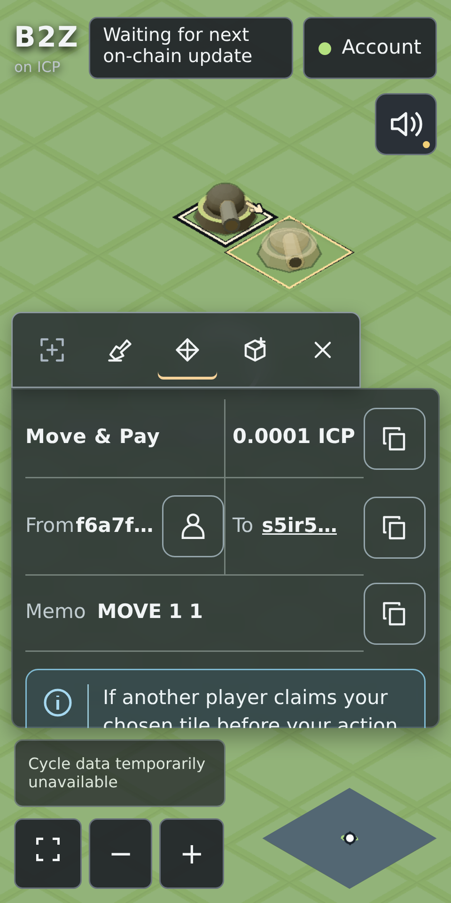

The warning remains fully reachable through the single financial scrollport on
short portraits; its clipped lower portion in a top-of-scroll screenshot is not
missing content. See the native journeys and exact retained sentence assertions.

## Joint editor — original pose, real visual-viewport changes and first Join

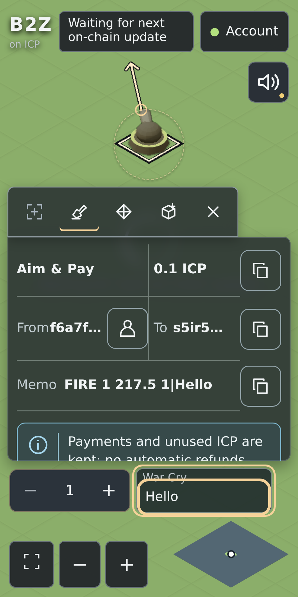
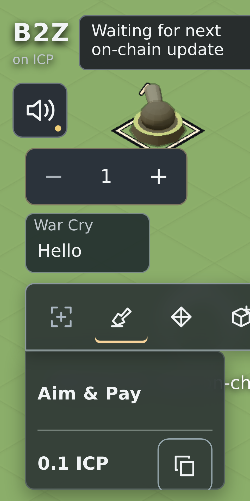
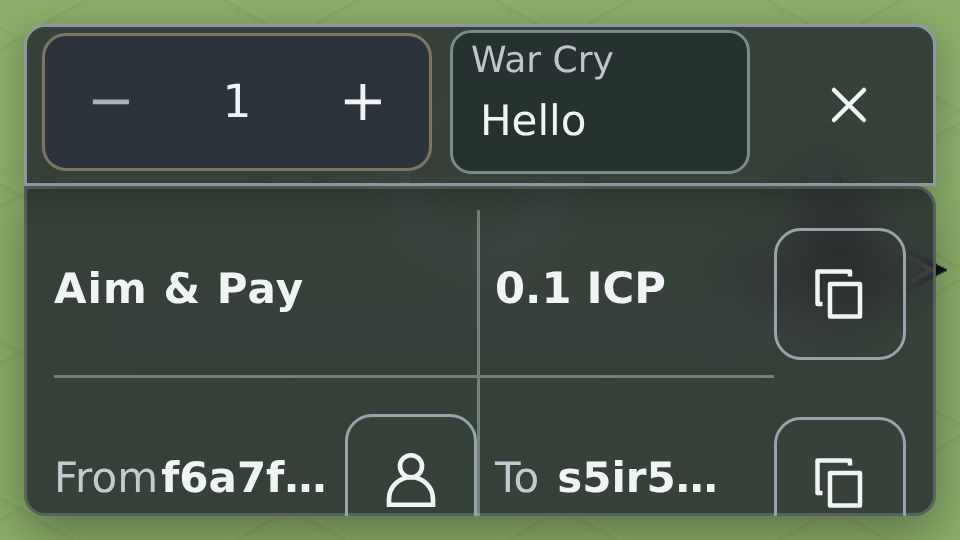
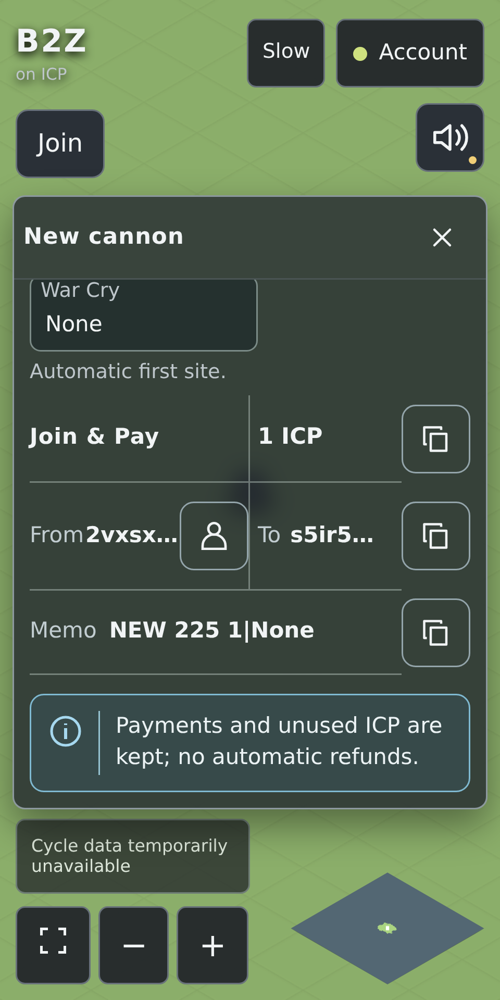

[320 native journey](captures/final-panel/320-journey0.webm),
[390 native journey](captures/final-panel/390-journey0.webm),
[desktop native journey](captures/final-panel/desktop-journey0.webm).
The first-Join recordings include native copy/paste into an external textarea and
denied-API fallback; these are clipboard tests, not a payment or wallet-app test.

## Actual authenticated disposable launch — two observers and lifetime

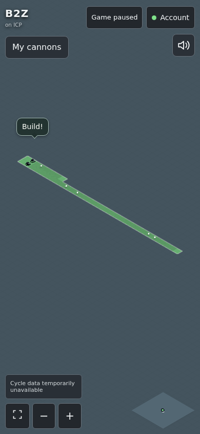
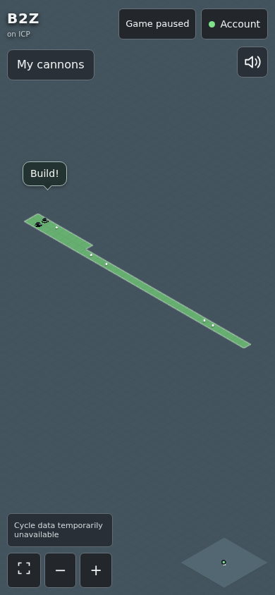
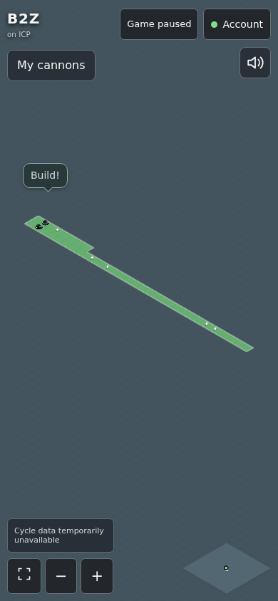
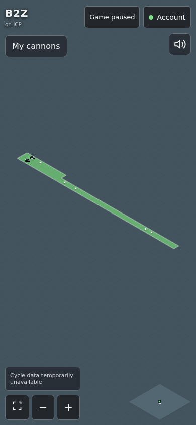

[Native bubble recording](captures/final-installed/speech-lifetime.webm).
Official valueless Ledger/Index records and the exact normal candidate produced
these events; no event/world injection supplied the bubbles. Full certificate,
chain, artifact, independent replay and lifetime results accompany the captures.

## Exact frozen frontend, actual mainnet read-only Rules7

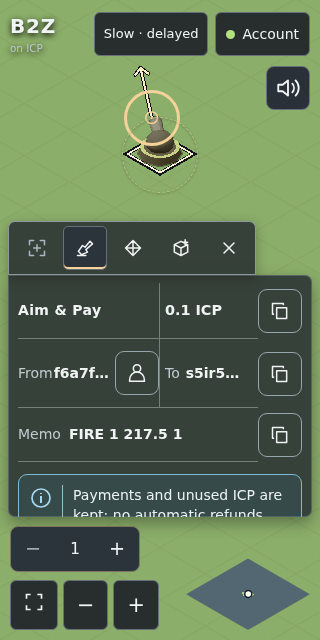
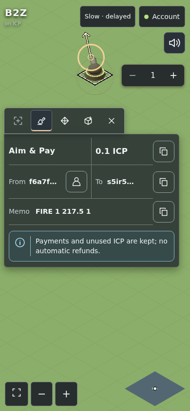
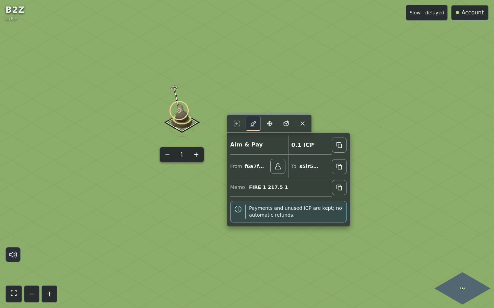

These use local frozen HTTP assets against the actual European backend. War Cry
is unavailable, full recipient/amount/memo copying passed, and no payment was sent.
They do not represent deployment of this candidate. Existing production stays on
the retained78-file audio/compact-control frontend.
