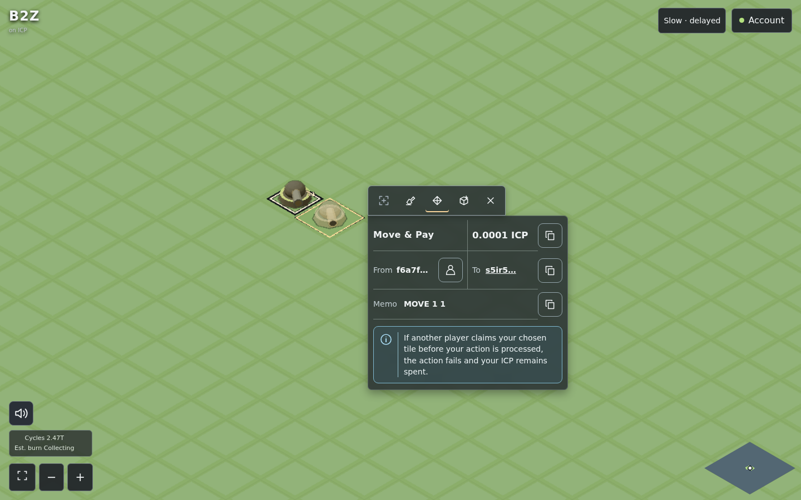
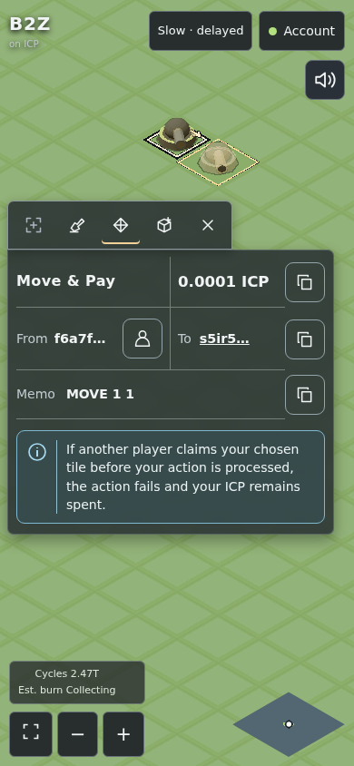
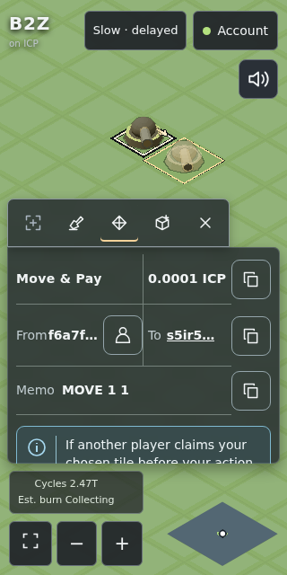
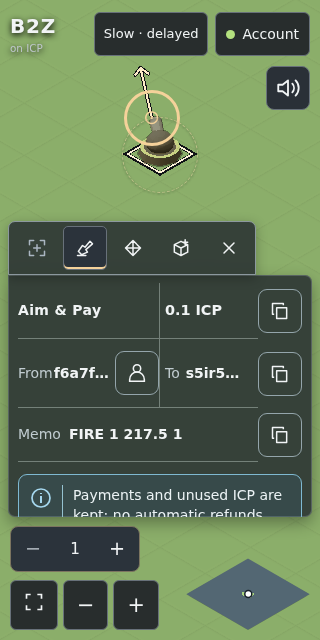
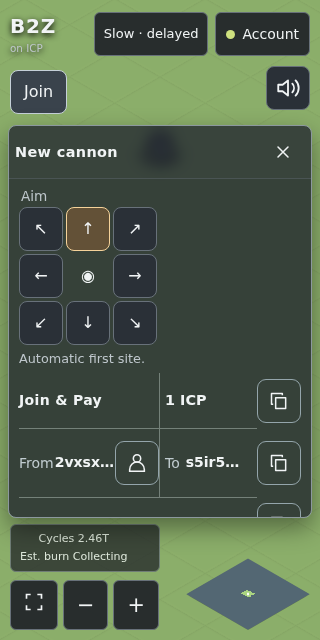
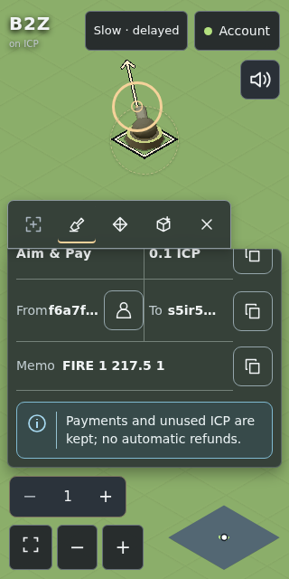
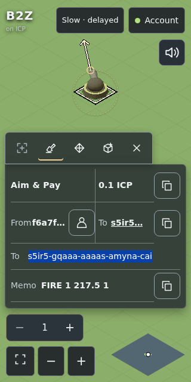
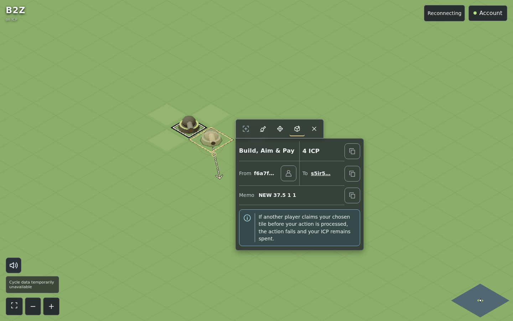

# Actual installed frontend captures

[Owner-approved reference](../reference/APPROVED_ACTION_PANEL.png). All views below
are production-browser captures, not rendered mocks. Desktop/emulated viewports
do not establish physical-phone performance.

[Mobile native journey](captures/critical-mobile-instrumented/video-0.webm),
[desktop payment journey](captures/live-controls-ready-event/video-1440-0.webm),
[native music-return output](captures/live-audio/production-music-return-0.webm).
The failed original gesture recording remains with its failure, not relabelled passing.
