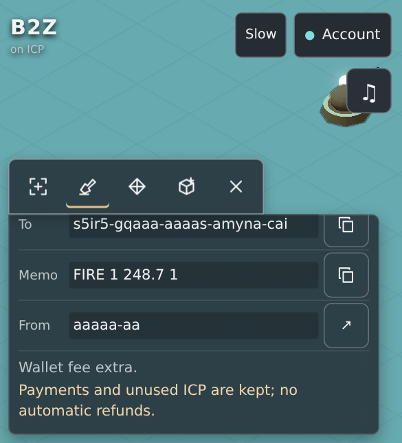
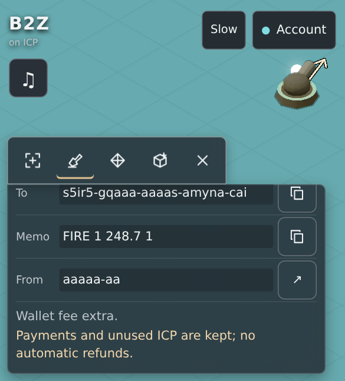

# Audio corrective qualification — NOT release-qualified

## Source and boundary

Starting published source: `c2818281219bcfb9979a32ff0d4e5ffbf658e4dc`.
Original audio runtime: `a2aa9a25c14b711e853857b013bbf0e4855ce8de`.
Corrected application runtime: `5a66aaf6bd8f83f8bf444ef5ea031ed34f3e260e`.
Final tested qualifier source: `db73806436d124cfb6707873d54004e575a794ae`.
Qualifier commits add native browser coverage and event-count/GC observations;
application/build/dependency inputs remain identical to runtime 5a66aaf. Final
report commits change documentation/evidence only.

AGENTS, STATUS, B2Z_AUDIO, the original audio evidence, and the independently
reviewed next-pass requirements were reconciled. The initially missing review
was subsequently supplied in the conversation; that prerequisite is resolved.
The original [report](../audio-integration/REPORT.md), [matrix](../audio-integration/QA.md)
and failures remain historical evidence under their actual source identities.

No push, merge, deployment, canister installation (including local), funding,
transfer, allowance, settings/controller change or mainnet operation occurred.
No backend, rules, financial, deterministic replay, payment or SDK input changed.
The production backend `s5ir5-gqaaa-aaaas-amyna-cai` and frontend
`s2jxj-liaaa-aaaas-amynq-cai` remain outside this operation. Normal external-wallet
instructions and disabled delegated payments are preserved.

## Hosted results — original source, not the correction

[Run 43458352816](https://github.com/aodl/balls-2-the-wallz/actions/runs/43458352816)
is complete for c281828: **four substantive PASS, two FAIL**.
[Recorded conclusions](hosted-starting-source.json) exclude the informational
`BLOCKED production inventory (not a pass)` job.

| Gate | c281828 conclusion | Corrected local candidate hosted result |
| --- | --- | --- |
| Source conformance | PASS | NOT_RUN — publication not authorized |
| Native conformance | PASS | NOT_RUN — publication not authorized |
| Packaged DTR / clean consumers | PASS | NOT_RUN — publication not authorized |
| Runtime-lab Wasm | PASS | NOT_RUN — publication not authorized |
| Browser HTTP / Web Crypto | FAIL | NOT_RUN — publication not authorized |
| S14 / million-cell installed-IC | FAIL | NOT_RUN — publication/install not authorized |

The Browser job 131998379211 fails the selected-source keyboard-contraction check;
its later audio steps were skipped. Installed job 131998379301 fails
`human_corrections_certified_startup_and_transient_recovery`: the browser waits
60s for music.active and four FX buffers after enabling both. Its screenshot says
Effects temporarily unavailable, while the game-error field is empty. The exact
underlying audio exception was not captured. Fixed-H startup had passed there.
A corrected installed run is still required; the activation fix below is a
reproduced mechanism consistent with this symptom, not a claimed hosted PASS. The branch/run were rechecked at 20:20:10 UTC: remote
head remains c281828 and conclusions remain 4 PASS / 2 FAIL; see [closeout snapshot](hosted-closeout.json).

Preserved downloaded artifacts:

- Browser 14056120852: `55f70765aea74953a946383491d72331251327fba8c41249baa927535e34c367`.
- Installed 14058483184: `115f61428f39d5a182b5e1b6c840691fed56b3092ba95bd7aa5ffccbcc51c0f9`.

## Responsive failure and smallest correction

The unchanged assertion reproduces at **390x430, DPR 1.5**, following financial
field scrolling. Selected source screen point is `(335.6033,109.9646)`, camera
`[578.9081,456.6849,71.6076]`, no active camera tween. Audio controls occupy
x336..380/y66..110; native fractional-pixel hit-testing returns `.audio-controls`
ahead of `#board`. The image confirms the cannon is covered. This is an introduced
layout defect, not a demonstrated timing flake or a 320 px-only defect.

The same current fixture/camera under the previously qualified pre-audio `b292c0d`
HTML/CSS hits `#board` at the identical point. Its complete 390 journey and contracted
390x300 / 844x390 cases pass. Controlled left-anchoring then passes 1440/390/320
journeys, plus separate 390/320 repeats, with unchanged assertions/tolerances.

The production CSS change left-anchors audio controls/popover only in a narrow
short-edit viewport. It does not move the camera, panel, cannon or payment content.
The maintained regression now records geometry, hit stack, selection, scroll,
focus, camera/layout and screenshots immediately before the original assertion.

[Before geometry](original-c281-geometry.json), [qualified layout control](pre-audio-b292-geometry.json),
[corrected placement control](left-anchor-controlled-geometry.json).

[Corrected application geometry](corrected-5a66-geometry.json) is captured by the
maintained assertion in the current-source browser journey.

## Independent lanes and decoder recovery

Previously every lane toggle cancelled the shared loader. Enabling FX during
native music decode could cancel the music promise while the native decoder
continued; the next FX request then failed busy and set a persistent audio-only
error. The new deterministic engine regression fails on the previous code and
passes after correction; see [original failure](activation-before.log).

A partial toggle now fences old cues and stops the disabled lane without
cancelling the other lane's load. Full mute, both disabled, hide/freeze/dispose
still cancel generations. A new explicit load waits abortably at most 15s for the
old native decoder, before fetching, and checks generation again. The old request
stays rejected, its late result cannot start audio, and max concurrent decode
remains one. No musical files, tempo, scheduling rate, effects budgets or replay
application changed. The new loader test retains cancellation/single-flight checks.

Actual native Chromium game playback with a controlled 500 ms native decode delay
passes simultaneous Music/FX enable, independent toggles, hash rejection/retry,
saved-enabled silent reload, two-tab ownership, context loss and optional cache
recovery. [Controls results](controls.json) retain the precise scopes. An actual
pinned recording verifies/renders while a FLAC request is held; that is offline
content verification, not IC network-priority qualification.

## Performance — original P09 remains FAIL

The original failed run recorded dense incremental p95/p99=25.9494/39.3794 ms.
Its 100k synthetic median/p95/p99 were 138/178/195 ms. Those failures remain
attached to their original source and host conditions; they are not rewritten.

[Measurements](performance.json) keep actual SegmentPlayer A/B, OFF/OFF and ON/ON
controls, warmups, 1000 pairs/scene, separate instrumented prepare/accept/take, and
synthetic dispatch/CPU measurements. On/off public endpoints match. The maintained
benchmark also asserts full displayed event counts and records observed GC/heap.
Timing wrappers run separately from A/B; their overhead is not subtracted.

The loaded dense scene (20 projected events) has A/B median 0.0455 ms,
p95/p99 **23.706/35.404 ms**. OFF/OFF p99=29.885 ms, ON/ON p95/p99=23.092/37.345 ms.
The requested <=0.5/<=2 ms targets are not met on this wall-time measurement.
They were not relaxed. Representative hardware remains **BLOCKED**.

The 100k synthetic classification feed has wall median 103.170 ms but thread-CPU
median 7.070 ms (p95/p99 CPU 7.688/8.056), with 95 inspections. Empty counting loop wall
p95/p99=30.493/36.610 ms versus CPU 1.013/1.118 ms. This directly exposes scheduling
noise; it does not prove every spike is scheduling or qualify dense gameplay.

Bounded inspections do not bound the full mandatory loop: N method calls,
branches and stride/modulo decisions remain O(N). The original synthetic loop
also calls accept(null), unlike the actual player. Expensive trajectory math and
cue allocations remain bounded. No second event pass or world scan was added.
A trial cached-stride refactor gave no demonstrated CPU improvement (~7.33 ms
versus 7.14 ms in the earlier comparison), so it was reverted. An all-wall-only
sampling experiment is diagnostic, not a valid mixed-launch production change.
Earlier quieter shared-host A/A controls are retained in raw evidence; they do
not substitute for representative hardware or independently qualify this source.

The quieter, graphics-quiescent rerun has dense paired median/p95/p99
**0.0446/0.3333/2.4021 ms**. OFF/OFF p99=2.2180 ms and ON/ON p99=3.8200 ms.
P99 still misses 2 ms. Observed GC:213 events,280.565 ms total,14.489 ms maximum;
heap 6,337,648 ->12,531,824 bytes across the complete benchmark. This is not a
long-lived application leak measurement. The 100k feed has median 13.707 ms wall
versus 6.755 ms thread CPU. [Sequential measurements](performance-sequential.json)
retain all scenes, controls and stage timings; no budget or fixture was removed.

[Actual native profile summary](native-profile-summary.json) separates sampled
module stacks from replay/rendering. Sampling is 1 ms and time deltas include
scheduling delay; it is not an exact CPU or p99-budget proof. Native decoder worker
CPU is not measured. QA inspect/prototype telemetry adds test-only work. Raw
profiles and traces remain separately hashed under `.work/audio-corrective`.

## Scoped correctness and outstanding matrix

[Spatial results](spatial.json) pass all nine 1440x900/390x844/320x640 × DPR 1/2/3
contexts. They exercise actual renderer membership, native Web Crypto and actual
Camera projection; zoom 12/20/30/40 CSS pixels per tile; document scroll 100 px;
canvas offset 20/30 px; real header/minimap/action/audio nodes deliberately placed
across the source; and toroidal seam/pan poses. These are controlled browser
geometry tests, not physical audio or installed-IC evidence.

E08 passes two adjacent canonical kernel segments within one native RAF callback,
8 displayed events (4+4), audio-on/off endpoint/index equality and distinct cue
roots while latest-authority binding remains the second publication. These roots
are canonical fixture bindings, not IC certificates. Native voice starts are
separately covered by the integrated reflection and budget tests.

The native follow/navigation probe passes: real keyboard B selects/follows the
verified displayed ball, a controlled DOM navigation key invokes the normal
camera tween/interruption policy, and actual stereo-panner automation changes
(0.02618/0.05929/0.10759 in one run). Navigation stops follow; Escape remains usable.
[Native results](native.json) and [native follow screenshot](media/native-follow-pan.png)
retain the precise scope. This is not a hardware latency benchmark.

[Native UI occlusion](native-occlusion.json) passes all four actual nodes in
controlled overlap poses. Each schedules an actual native source stop 65 ms ahead,
using the normal ResizeObserver/MutationObserver invalidation, without manually
calling layout refresh. [Header](media/native-header-mask.png),
[minimap](media/native-minimap-mask.png), [panel](media/native-panel-mask.png)
and [audio popover](media/native-audio-mask.png) captures show the test poses.

The visible-default-headless CDP freeze attempt delivered no events and remains
recorded BLOCKED in that scoped case. A later ordinary sandboxed Chromium, with
loopback-only debugging and `no_defaults`, uses real tabs in the SAME window:
actual document.hidden, freeze/resume events, automatic sound recovery and the
same game session/clock/queue all pass. No visibility property or browser policy
is spoofed/disabled. Real BFCache pageshow.persisted=true restores the same marker
and preserves mute. Two native runs pass; [lifecycle evidence](native-lifecycle.json)
and [return capture](media/native-visibility-return.png) retain the events.

The first BFCache test wrongly awaited DOMContentLoaded, which a cache restore
did not emit. [Preserved failure observation](lifecycle-original-failure.json)
shows pageshow.persisted=true, ready=true and mute=true despite that timeout.
Waiting for navigation commit plus actual ready/persisted/marker conditions fixes
the verifier; no application state is fabricated or reset.

Actual physical OS/device suspension, Safari/iOS/Android, physical 44.1k output,
Bluetooth/headphone routing and listening remain BLOCKED/NOT_RUN. The full
slow-link certified-IC priority case remains BLOCKED by this task's no-install/
no-mainnet boundary; the positive pinned-recording held-FLAC case is narrower.

[Manual listening/device/release procedure](MANUAL_ACCEPTANCE.md) includes music-only
and FX-only A/B, 16/32/64 entities, headphones/phone speakers, real keyboard,
route interruptions, network stalls and tab ownership. Commercial-use/provenance
rights for all supplied Suno tracks remain UNRESOLVED and must be documented
before public release. Unit tests cannot establish these rights.

## Frozen assets and economics

[Complete inventory](frozen-inventory.json) and [summary](frozen-summary.json):

- JavaScript: `cba3eb98c63bb513494500de7f1b79550a1ba4332ee50181529839c6252eed0e`.
- Complete 74-file inventory: `b4abc541bf7277dbae865f4269d1abd12cc4d6e0bcba39bcf2b21a875c1ae72f`.
- 74 files, 76,234,102 bytes; 73 public files plus consumed policy.
- Clean source `5a66aaf` provenance. Only `app.mjs`, `style.css`, `build-manifest.json` differ
  from the original frozen inventory. This is a new candidate, not relabelled old bytes.
- All 57 approved FLAC hashes remain exact; encoded FLACs 74,057,243 bytes plus
  manifest 30,532 bytes. Manifest SHA remains
  `d26588b58524710683bd9937a45395ea232eb3a891f4d3a910e1f4283d503db7`.
- [Local static HTTP](frozen-http.json) verifies all 73 served public bodies and
  frozen-policy CSP. This is not a newly installed asset-canister/certificate check.
- Upload policy, frontend/backend binding, dependencies and frozen base builder
  remain unchanged; no signing or delegated-payment functionality was added.

The earlier disposable asset rehearsal measured 1,718,676 -> 81,279,380 stored
bytes. No installation was repeated here; no production cost was measured.
Lazy loading avoids boot downloads; repeat cold/evicted listeners still download
music. Cache is bounded 90 MiB. Production capacity, upload staging, cycles and
actual download charging require separately authorized operator assessment.

The previously observed deployed pre-audio JS `9d45b940…` / inventory `f85e3ddf…`
remains preserved in
`.work/s14/assets`; its full JS hash was rechecked locally this pass. No fresh
production query was made. Earlier rollback bytes remain separately retained. Any later
deployment/rollback must follow the frontend-only assets procedure in
`docs/operations/S14_OPERATOR.md`. Do not use an unrestricted deployment or touch
the paid backend. No production rollback was necessary or performed here.

## Execution history and remaining release decision

[Selected raw hashes](raw-artifacts.json) bind the retained originals. Raw work
lives under `.work/audio-corrective`, including original failure logs,
hosted artifacts, diagnostic controls, profiler/CPU data and browser trace.
The trace is from actual game controls/recording verification, not IC authentication.
Original failures are preserved rather than rewritten as passes.

The initial broad verification overlapped graphics/CPU jobs and exhausted 600s
Node and 180s source-structure deadlines; Python 201 passed. Two forecast cases
also hit their existing 2000 ms work windows there, then passed in an isolated
rerun. That does not erase the failed full run. The first sequential rerun also failed the unchanged 600s Node deadline and
recorded three forecast work-window failures. Those failures remain preserved.
The final db73806 run, with graphics quiescent, passes the COMPLETE source gate:
**1908/1908 Node, 201/201 Python**, syntax/structure, vectors, locks and docs;
[exact command/results](source-closeout.json). No assertion/deadline was relaxed.
The formerly failing forecast tests complete in 891.5/1831.2/1841.1 ms there under
their existing 2000 ms windows. This does not turn the earlier failed runs into passes.

Recorded refinement/native commands originally completed assertions but stalled
in context-only recording cleanup. Blank-page close controls passed. Explicit
page closure before context disposal resolves the known cases: focused 390 and
full 1440/390/320 recorded refinement pass and exit 0, as do the default full native
and 500 ms activation commands. Scene/financial/layout assertions are unchanged.
The earlier context-only stalls and interrupted attempts remain raw evidence.
A deliberate held-FLAC route also produced a Playwright cancellation warning in
old cleanup; settling its handler before unregistration now passes the targeted
500 ms native check with no cancellation warning; [results](cleanup-confirm.json).

The video-free and recorded complete refinement and visual journeys pass 1440/390/320.
The current action-panel matrix passes eight viewport/motion configurations:
**0 px drift across 2,396 sampled states** (24 action cases, 8 status transitions
each), including 320x300 contraction and reduced motion. This is the actual sample
count, not a repetition of the earlier 3552 result. Exact amounts/memos/recipient,
payer, warning, copy-readiness, camera and playback invariants remain asserted.
The recorded matrix independently gives 0 px over 2,379 sampled states.
See [recorded panel evidence](recorded-panel-geometry.json), [panel evidence](panel-geometry.json), [contracted Build status trace](contracted-build-status.json)
and [responsive results](refinement.json).

The COMPLETE local Browser gate steps pass, including exact recorded flags:
wire capture, HTTP/Web Crypto, ordinary player journeys, tactical grid/browser,
fluid/depth/elastic, recorded refinement/visual, human corrections/panel geometry,
native audio/core/transition, nine-context spatial, four-node native occlusion,
delayed decode and real visibility/BFCache. [Recorded commands](recorded-browser-commands.json),
[recorded refinement](recorded-refinement.json), [matrix](QA.md).

Fresh native music runs 1230s across three loops: 157 segment starts, zero underruns,
max 3 buffers/2 sources and 9,331,200 owned decoded music bytes; [loop evidence](three-loop.json).
The earlier 1170s interrupted attempt is not counted as a three-loop PASS.
All 51 native 48k core hashes match. Wrap and both internal-transition windows at
48k and 44.1k have zero differing samples; playbackRate 1/detune 0 is retained.
[Native results](native.json), [wrap excerpt](media/native-wrap-48000.wav),
[transition excerpt](media/native-transition-48000.wav). These are digital captures,
not headphone/speaker listening evidence. The native integration bundle differs
from frozen JS only in the trusted deployment binding being null/offline; all
other JavaScript bytes match [exact comparison](native-bundle-parity.json).

[Six-second recorded browser excerpt](media/recorded-390-excerpt.webm) is a
bitstream-only trim of an actual 390 px recording; no synthetic frames or added
audio. Full originals, trace and CPU profile remain raw with hashes.

No corrected source is release-qualified until all six hosted gates pass for its exact published SHA, physical
performance/listening/device prerequisites are met, and rights/costs are reviewed.
Do not deploy this candidate. Review local corrections/evidence, resolve remaining
limitations, then separately authorize normal non-force publication for qualification.
