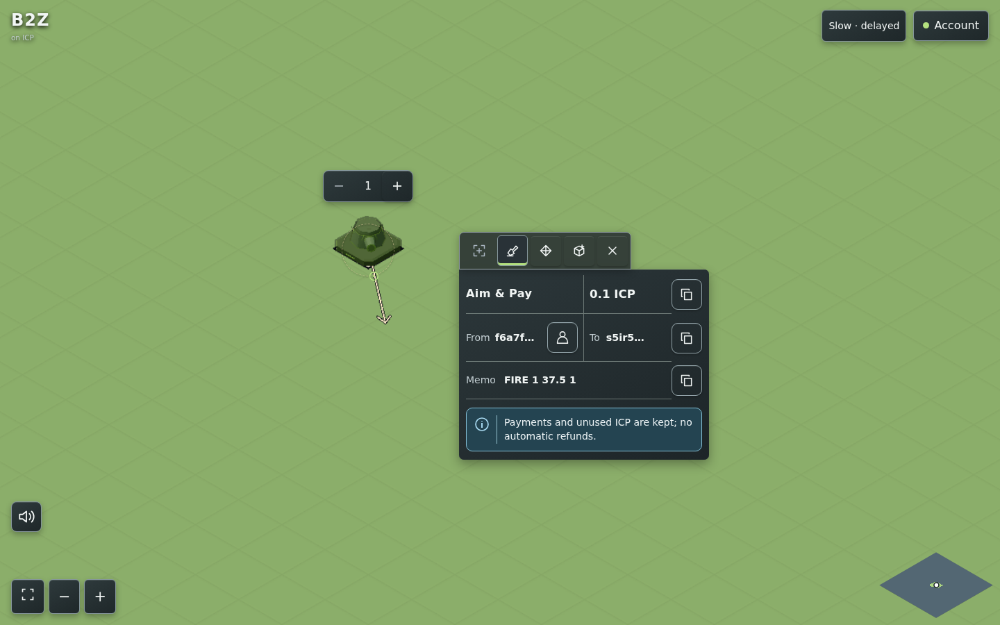
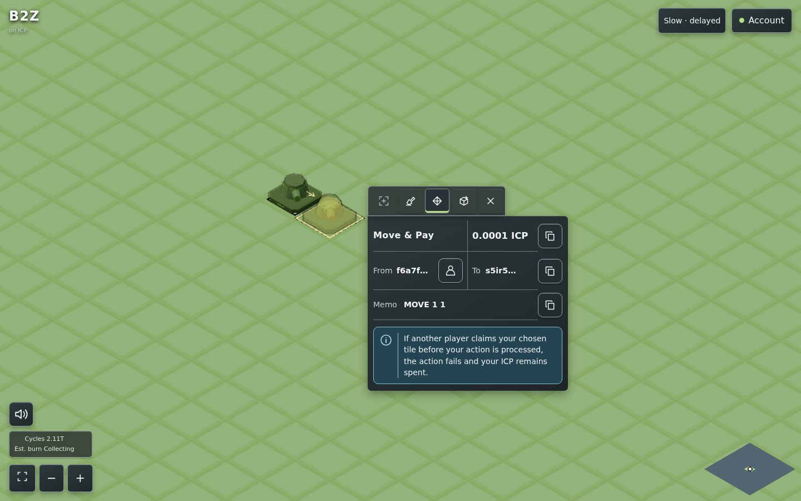
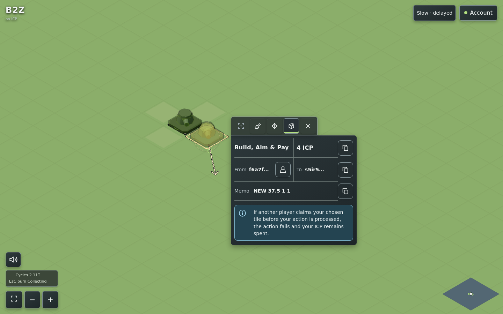
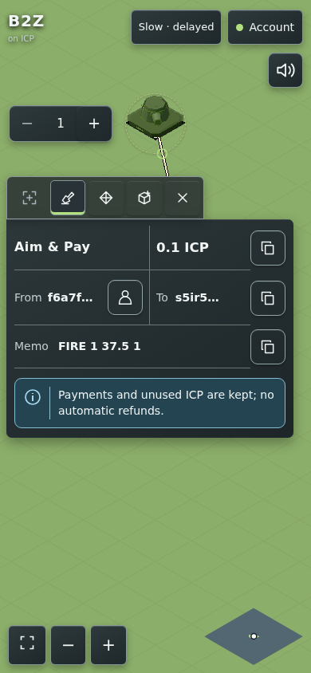
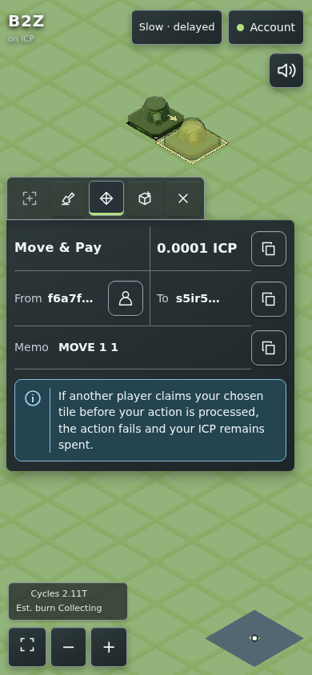
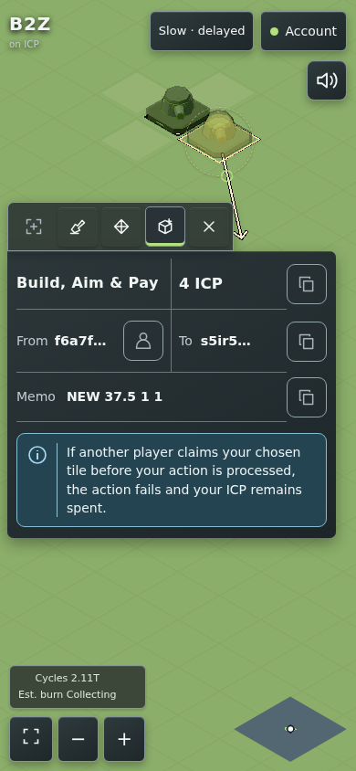
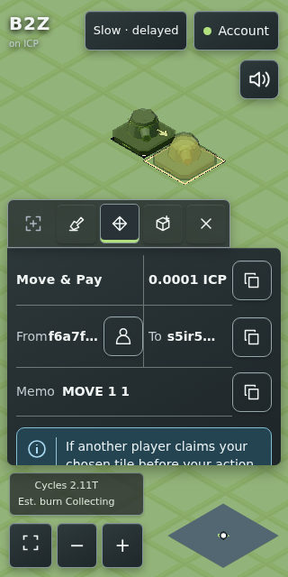
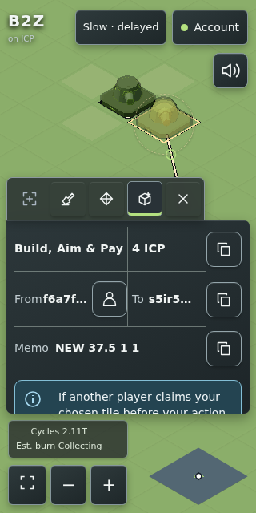
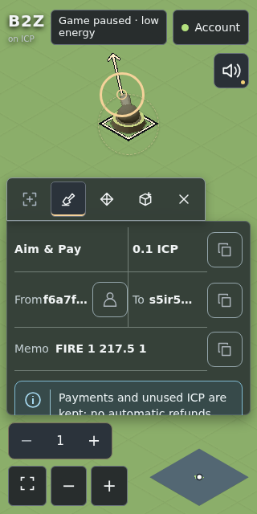
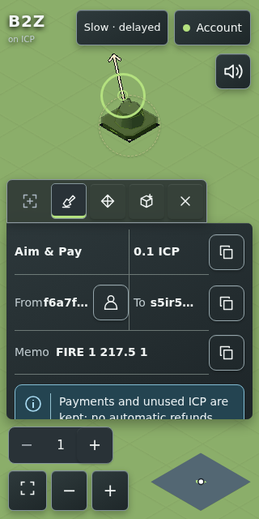

# Actual application and renderer captures

**The Deflector mechanic is not implemented.** No authenticated redirect-chain or disposable Deflector-payment video is offered. These are explicitly separate frontend/rendering captures; none is a paid construction or fabricated successful turn.

## Approved references

- [Visual language](reference/01_APPROVED_VISUAL_LANGUAGE.png)
- [Armoured cannon](reference/02_APPROVED_CANNON.png)
- [Square-mounted wedge](reference/03_APPROVED_DEFLECTOR.png)
- [Exact panel structure](reference/04_APPROVED_PANEL_STRUCTURE.png)
- [Owner-supplied prior UI](reference/05_CURRENT_UI_BASELINE.png)
- [Owner-supplied prior cannon](reference/06_CURRENT_CANNON_BASELINE.png)

## Exact25ac frozen frontend — actual authenticated mainnet-backed application

The frontend is served locally from its unchanged frozen bytes. The backend is the real certified Rules7 game. This is **not a production deployment**. Mouse/keyboard and browser-emulated touch are real native input; no physical-phone acceptance is inferred.

|Width|Fire|Move|Build|
|---|---|---|---|
|1440||||
|390||||
|320||||

- [Exact320×640, cell0,347.15°](results/indexed-acceptance/critical-mobile-instrumented/347.15.png)
- [Critical native result/geometry/heading sweep](results/indexed-acceptance/critical-mobile-instrumented/results.json)
- [Exact native/API clipboard bytes](results/indexed-acceptance/live-clipboard-fields/results.json)
- [Network/status/zero-drift result](results/indexed-acceptance/live-panels-recovery/results.json)

Native recordings of the exact frozen application:

- [critical-mobile-instrumented/video](results/indexed-acceptance/critical-mobile-instrumented/video/page@26880affc066f6ea47bfd8b9a71b7371.webm)
- [live-panels-recovery/video-1440](results/indexed-acceptance/live-panels-recovery/video-1440/page@44f7e252f335f8573f4fbbd9d580f9ad.webm)
- [live-panels-recovery/video-320](results/indexed-acceptance/live-panels-recovery/video-320/page@e6226301b681d854903b3fbf80f86e8b.webm)
- [live-panels-recovery/video-390](results/indexed-acceptance/live-panels-recovery/video-390/page@5aed983ba207fd49c29fbd5c28438476.webm)

## Matched original pose and final pose

|Before (original renderer, controlled canonical fixture)|After (final freeze, actual Rules7 data)|
|---|---|
|||

Camera/cell/screen heading are matched. Operational status/world time and evidence provenance differ; the controlled before fixture intentionally exercises protection, while the actual after backend was ready. Those status differences are not caused by the theme. This is not a pixel-identical timed-world comparison.

## Final indexed shared renderer — synthetic art scenes

These use the actual renderer/model factory from the final indexed runtime. The square wedge is a model in a controlled render fixture, **not an admitted game structure**. Palette-extreme overrides test contrast and do not change the canonical game palette. Physical tile bounds are proven analytically and over65536 headings.

### 1440px

- [Working scale](results/final-model-gallery/1440-working-scale.png)
- [Palette extremes](results/final-model-gallery/1440-palette-extremes.png)
- [Heading 0°](results/final-model-gallery/1440-models-0.png)
- [Heading 22.5°](results/final-model-gallery/1440-models-22.5.png)
- [Heading 45°](results/final-model-gallery/1440-models-45.png)
- [Heading 90°](results/final-model-gallery/1440-models-90.png)
- [Heading 135°](results/final-model-gallery/1440-models-135.png)
- [Heading 180°](results/final-model-gallery/1440-models-180.png)
- [Heading 225°](results/final-model-gallery/1440-models-225.png)
- [Heading 270°](results/final-model-gallery/1440-models-270.png)
- [Heading 315°](results/final-model-gallery/1440-models-315.png)

### 390px

- [Working scale](results/final-model-gallery/390-working-scale.png)
- [Palette extremes](results/final-model-gallery/390-palette-extremes.png)
- [Heading 0°](results/final-model-gallery/390-models-0.png)
- [Heading 22.5°](results/final-model-gallery/390-models-22.5.png)
- [Heading 45°](results/final-model-gallery/390-models-45.png)
- [Heading 90°](results/final-model-gallery/390-models-90.png)
- [Heading 135°](results/final-model-gallery/390-models-135.png)
- [Heading 180°](results/final-model-gallery/390-models-180.png)
- [Heading 225°](results/final-model-gallery/390-models-225.png)
- [Heading 270°](results/final-model-gallery/390-models-270.png)
- [Heading 315°](results/final-model-gallery/390-models-315.png)

### 320px

- [Working scale](results/final-model-gallery/320-working-scale.png)
- [Palette extremes](results/final-model-gallery/320-palette-extremes.png)
- [Heading 0°](results/final-model-gallery/320-models-0.png)
- [Heading 22.5°](results/final-model-gallery/320-models-22.5.png)
- [Heading 45°](results/final-model-gallery/320-models-45.png)
- [Heading 90°](results/final-model-gallery/320-models-90.png)
- [Heading 135°](results/final-model-gallery/320-models-135.png)
- [Heading 180°](results/final-model-gallery/320-models-180.png)
- [Heading 225°](results/final-model-gallery/320-models-225.png)
- [Heading 270°](results/final-model-gallery/320-models-270.png)
- [Heading 315°](results/final-model-gallery/320-models-315.png)

## Retained failures and scope

- [Hosted neutral-mask failure capture](results/hosted-fa935/ci-fluid-depth/normal.png)
- [Hosted mask/overdraw log](results/hosted-logs/fa935-browser.log)
- [Hosted merged-preview KeyError log](results/hosted-logs/9e6df-browser.log)
- [Corrected geometric-mask negative control](results/depth-mask-v2/results.json)
- [All acceptance dispositions](ACCEPTANCE_RESULTS.csv)
- [Matched A/B/B/A performance](PERFORMANCE.md)

Failed/provisional captures remain in their named result directories; they are not labelled final qualification. Physical devices, subjective listening and Deflector authenticated gameplay remain separate unverified or unimplemented scopes.
