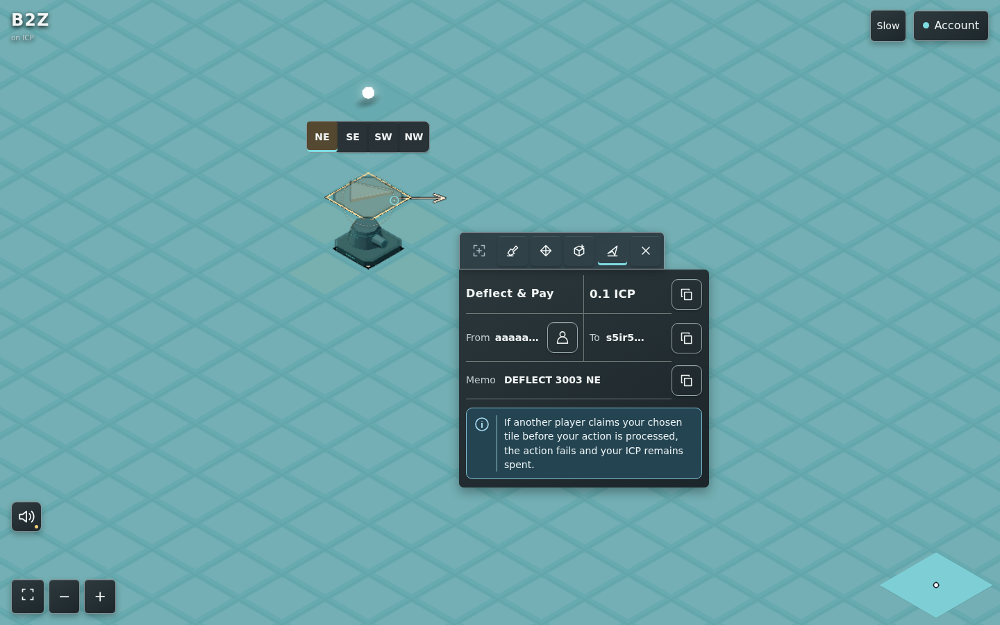
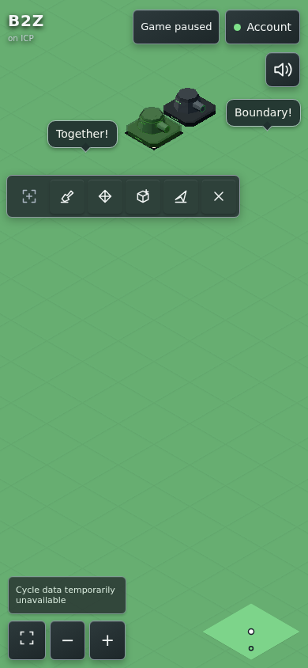

# Actual native application captures — not physical-phone qualification

Current shared composer/renderer, synthetic Rules12 fixture, real browser input:

| Desktop1440×900 | Portrait390×844 | Narrow320×640 |
|---|---|---|
|  |  |  |

All four matrix directions are captured at each width: replace `NE` with `SE`,
`SW` or `NW` in the image paths. `results/final-controls-local.json` records
actual target bounds, clipboard values, source-camera/quantity invariants,
Update/Keep, protected/reconnect status geometry and context restoration.

Two independent native observers of the real disposable normal-module game;
structures created by official valueless Ledger transactions. A later real enemy
FIRE cuts off the right section. The near-cannon Deflector disappears; the cannon
enters dormancy. Another Deflector remains in the supported left section.

| Observer | Before committed loss | After committed loss |
|---|---|---|
| 0 |  |  |
| 1 |  |  |

These are actual authenticated displayed transitions, not renderer-injected
purchase/collision mocks. Certificate/wire and independent replay evidence are
separate in `results/destruction-certificate-replay.json`; observer timing/state
is in `results/destruction-browser.json`. Raw native videos remain under the
corresponding `.work/boundary-deflector` test directories. No production change
or physical-device/audio-performance pass is implied.

Native-input videos (browser capture; no physical-device/audio-output claim):
[desktop controls](captures/controls-1440.webm),
[portrait controls](captures/controls-390.webm),
[narrow controls](captures/controls-320.webm),
[observer0 destruction](captures/destruction-observer-0.webm),
[observer1 destruction](captures/destruction-observer-1.webm).

Fresh real valueless FIRE after both observers were authenticated, with existing
Rules11 War Cry semantics preserved alongside purchased Deflectors:

`results/live-cry-browser.json` records matching successful-launch provenance,
ordinary5/35-second visibility transitions and55+5-second bubble lifetime.
