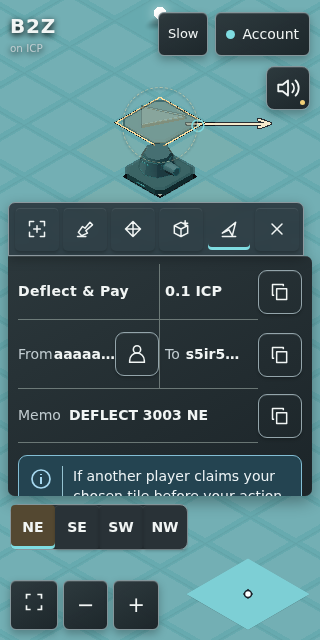
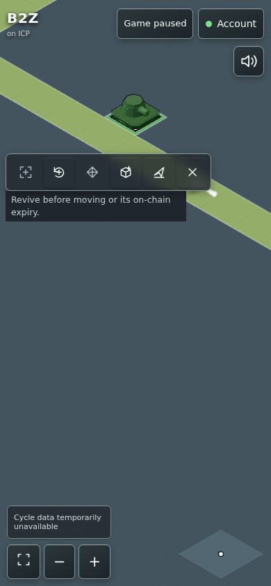
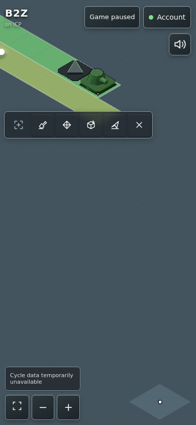
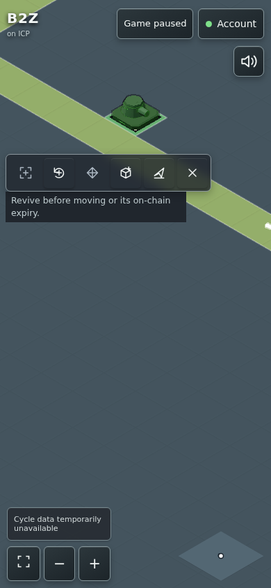
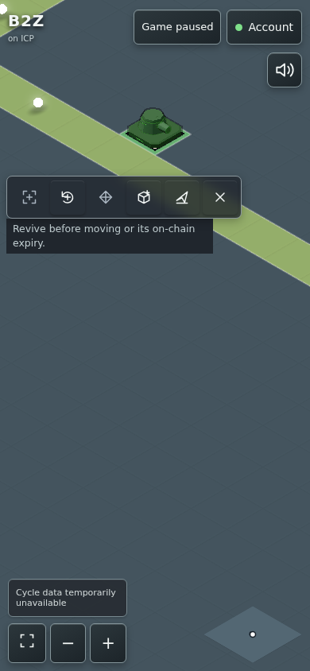
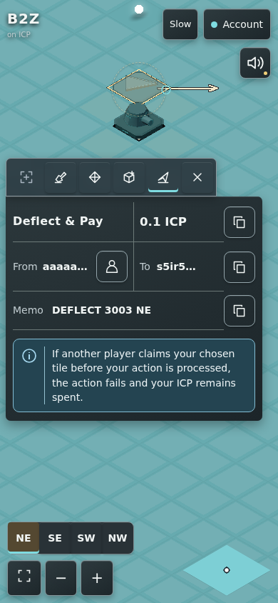
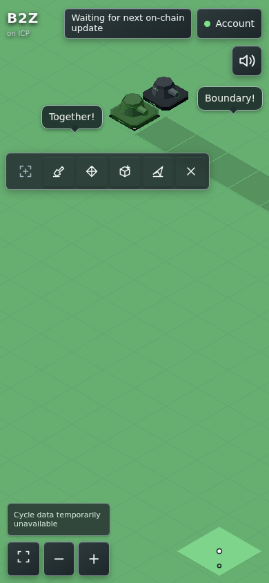
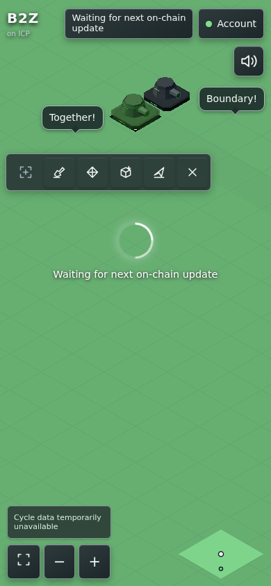
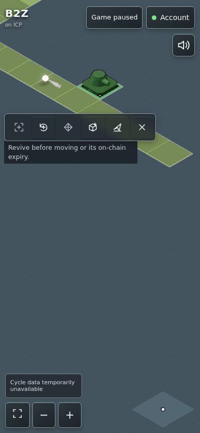
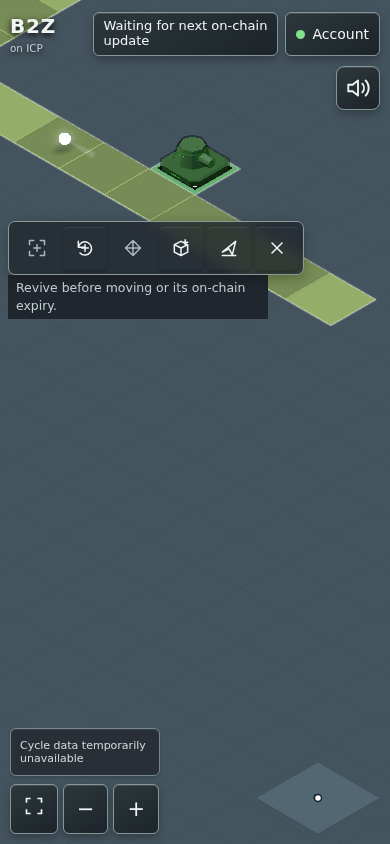

# Actual native application captures — not physical-phone qualification

The retained [approved payment-panel reference](../../approved-action-panel-war-cry/reference/APPROVED_ACTION_PANEL.png) remains the structure contract. Shared dividers, read-only values, person reassociation and Copy axis are tested; the graphite theme preserves that layout.

Current shared composer/renderer, synthetic Rules12 fixture, real browser input:

| Desktop1440×900 | Portrait390×844 | Narrow320×640 |
|---|---|---|
|  |  |  |

All four matrix directions are captured at each width: replace `NE` with `SE`,
`SW` or `NW` in the image paths. `results/final-controls-local.json` records
actual target bounds, clipboard values, source-camera/quantity invariants,
Update/Keep, protected/reconnect status geometry and context restoration.

Two independent native observers of the real disposable normal-module game;
structures created by official valueless Ledger transactions. A later real enemy
FIRE cuts off the right section. The near-cannon Deflector disappears; the cannon
enters dormancy. Another Deflector remains in the supported left section.

| Observer | Before committed loss | After committed loss |
|---|---|---|
| 0 |  |  |
| 1 |  |  |

These are actual authenticated displayed transitions, not renderer-injected
purchase/collision mocks. Certificate/wire and independent replay evidence are
separate in `results/destruction-certificate-replay.json`; observer timing/state
is in `results/destruction-browser.json`. Raw native videos remain under the
corresponding `.work/boundary-deflector` test directories. No production change
or physical-device/audio-performance pass is implied.

Native-input videos (browser capture; no physical-device/audio-output claim):
[desktop controls](captures/controls-1440.webm),
[portrait controls](captures/controls-390.webm),
[narrow controls](captures/controls-320.webm),
[observer0 destruction](captures/destruction-observer-0.webm),
[observer1 destruction](captures/destruction-observer-1.webm).

Fresh real valueless FIRE after both observers were authenticated, with existing
Rules11 War Cry semantics preserved alongside purchased Deflectors:

`results/live-cry-browser.json` records matching successful-launch provenance,
ordinary5/35-second visibility transitions and55+5-second bubble lifetime.

Corrected API normal module353699e4, actual paid destruction rehearsal:

| Observer | Before | After |
|---|---|---|
|0|||
|1|||

[Corrected observer0 video](captures/corrected-removal-0.webm),
[corrected observer1 video](captures/corrected-removal-1.webm).
The full runner passed226.778 seconds; both actual verified maps and passive
render samples agree. Strict signed-wire capture, independent replay and six
Deflector-specific tampering negatives passed. This is local disposable
normal-module evidence, not final hosted or production acceptance.

Final-source hosted native controls atf819257 (synthetic supporting Rules12 scene;
real browser input, no production/payment claim):

| Desktop1440×900 | Portrait390×844 | Narrow320×640 |
|---|---|---|
||||

All four direction captures are retained in the same directory. Hosted native
Clipboard API/external paste/manual fallback, direction/matrix checks, frozen
Update/Keep, protected/reconnect editor availability and zero geometry drift
passed. Browser gate also passes original347.15° quantity and full native audio
qualification. The installed-IC conclusion remains separate.

Final exact-source hosted installed game, normal2cb2fe, official valueless
Ledger/Index transactions and authenticated replay (not production/physical-phone
acceptance):

| Observer | Authenticated speech after successful launch |
|---|---|
|0||
|1||

| Observer | Before support loss | After committed destruction |
|---|---|---|
|0|||
|1|||

[Launch/redirect native video](captures/hosted-f819257/installed/boundary-deflector/observer-0.webm),
[destruction observer0](captures/hosted-f819257/installed/boundary-destruction-observers/observer-0.webm),
[destruction observer1](captures/hosted-f819257/installed/boundary-destruction-observers/observer-1.webm).
Both actual verified maps agree; strict certificate/wire capture, independent
replay and forged/omitted destruction/source-order negatives pass. Final installed
suite completes73 checks/65 installed cases, all8 Deflector cases passing.
